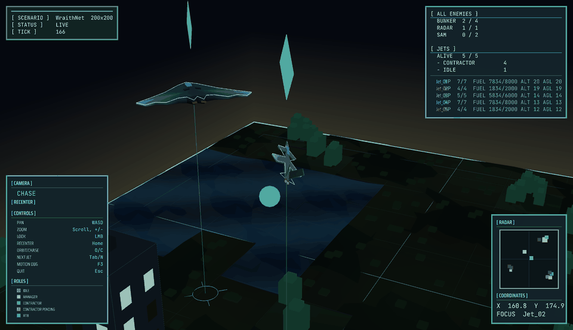
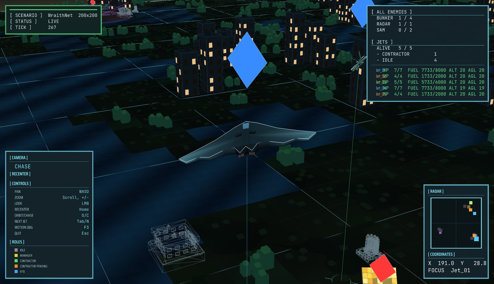
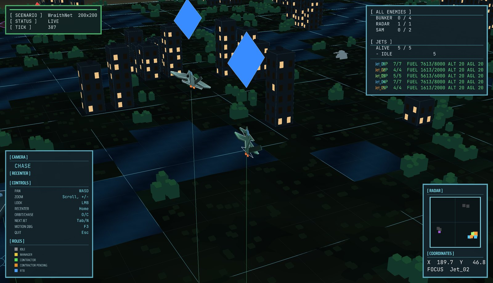
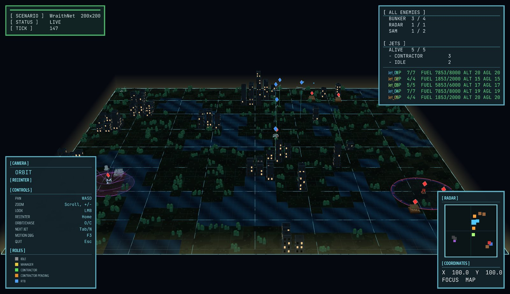
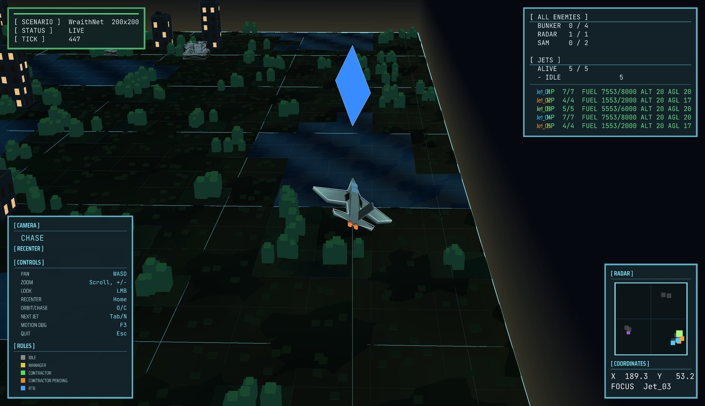
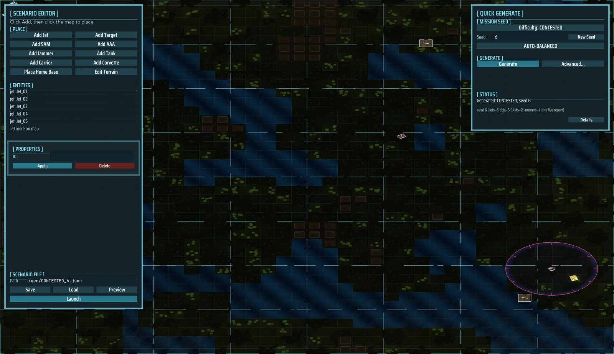
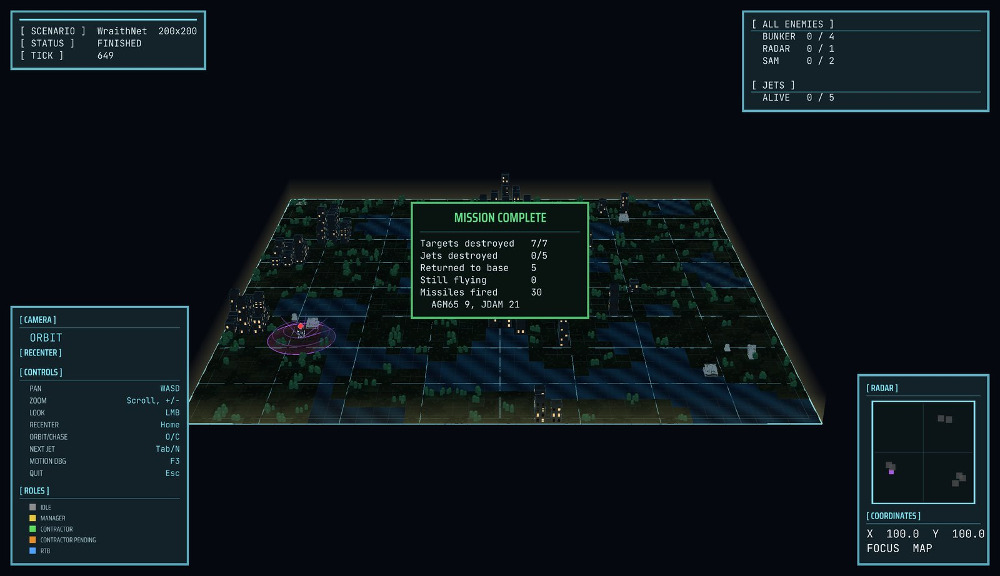
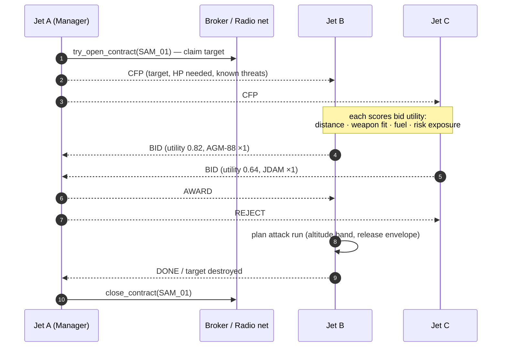
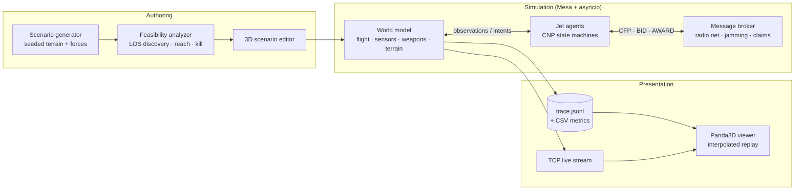

<div align="center">

# WraithNet

**A swarm of autonomous jets that negotiate who strikes what, then fly the mission in 3D.**

*Multi-agent simulation of 6th-generation "loyal wingman" tactics. There's no central commander: every jet bids for targets over a simulated radio, and the 3D viewer shows the whole engagement live.*




<sub>Live replay, chase camera: an interceptor weaves between city blocks while the rest of the swarm works its contracts (radar, HUD and roster on the right).</sub>

</div>

---

## Table of contents

1. [Why WraithNet?](#why-wraithnet)
2. [Highlights](#highlights)
3. [See it in action](#see-it-in-action)
4. [How the swarm thinks](#how-the-swarm-thinks)
5. [Architecture](#architecture)
6. [The battlespace](#the-battlespace)
7. [Engineering quality](#engineering-quality)
8. [Quick start](#quick-start)
9. [Controls](#controls)
10. [Project layout](#project-layout)
11. [Documentation](#documentation)

---

## Why WraithNet?

Modern air-combat concepts pair crewed fighters with **swarms of autonomous drones**. The hard part isn't flying one drone. It's getting a group of them to split up the work without a single point of failure, while they're losing radio links, being jammed and being shot at.

WraithNet is a simulator for exactly that problem. Each jet is an independent agent with its own sensors, fuel, munitions and memory. The jets coordinate only by passing messages over a simulated radio net, which can be jammed. They use the **Contract Net Protocol (CNP)**, a classic distributed-AI auction:

1. One jet that spots a target becomes the **manager** and sends out a call for proposals.
2. The others **bid**, based on distance, weapon fit, fuel and the threats they know about.
3. The best bidder becomes the **contractor**, plans an attack run and delivers the weapon.

Every behaviour you see in the viewer comes out of these negotiations. Nothing is scripted.

## Highlights

| | |
|---|---|
| 🛩️ **Decentralised decision-making** | Contract Net Protocol with risk-aware bids, broker claims, stale-contract expiry and contractor-loss recovery |
| 🎯 **Real tactical trade-offs** | Jets fly under SAM radar cover, climb over flak ceilings and match each weapon to its target type |
| ✈️ **Flight model with pitch, roll and heading** | Altitude changes are flown with the nose (no vertical sliding). Terrain-following uses an auto-GCAS-style look-ahead that clears buildings and treetops. Weapons can only be released inside their attitude and altitude limits |
| 🌍 **Procedural worlds** | Seeded terrain (cities, forests, water) and enemy layouts. Four difficulty presets. Same seed, same mission |
| ✅ **Static feasibility analysis** | Before launch, a solver checks that every objective can be discovered (line of sight), reached and killed with the weapons on hand |
| ⚔️ **Combined arms** | Radar and IR SAMs, AAA guns, jammers, tanks, corvettes, carriers, flares, missile notching, return-to-base and carrier recovery |
| 🎥 **Smooth 3D replay** | Panda3D viewer with orbit and chase cameras, a radar minimap and a HUD. Discrete ticks are interpolated to 30–60 FPS |
| 🧰 **Built-in scenario editor** | Generate, hand-edit, check feasibility, preview and launch, all from one app. Ships as a Windows `.exe` |

## See it in action

<table>
<tr>
<td width="50%"><br><sub><b>Strike run.</b> A heavy bomber heads for its contracted bunker while a SAM site's engagement ring glows below.</sub></td>
<td width="50%"><br><sub><b>Low-level ingress.</b> Near SAM sites, jets drop under radar cover and the terrain-safety system keeps them clear of the rooftops.</sub></td>
</tr>
<tr>
<td width="50%"><br><sub><b>Theatre view.</b> A procedurally generated 200×200 battlespace with cities, forests, water and the enemy threat rings.</sub></td>
<td width="50%"><br><sub><b>Chase camera.</b> Follow any jet (<kbd>Tab</kbd>) and see its HP, fuel, altitude and height above ground in the roster.</sub></td>
</tr>
<tr>
<td width="50%"><br><sub><b>Scenario editor.</b> Quick-generate by difficulty and seed, place or edit any unit, then Preview or Launch.</sub></td>
<td width="50%"><br><sub><b>Mission debrief.</b> CONTESTED seed 6: 7/7 targets destroyed, 0 jets lost, all 5 back at base, 30 weapons expended.</sub></td>
</tr>
</table>

## How the swarm thinks



The protocol keeps working when things go wrong:

- **Jamming** cuts jets off from the radio net, so they act on stale knowledge.
- **Lost contractors** (shot down or out of fuel) trigger a re-auction.
- **Stale claims** expire after a configurable time limit, so no target stays locked forever.
- **Risk-aware bids** include known IR and radar threats. With no threats, the bid scores reduce to the original baseline.

**Altitude is a tactical choice.** In transit, a jet climbs over the highest known gun ceiling. Inside a SAM's low-level radius, it drops to the clearance floor, under the radar's minimum engagement height. Unguided weapons force a descent to release height. A predictive terrain look-ahead overrides all of this whenever a flown climb couldn't clear what's ahead.

## Architecture



- **Authoritative, tick-based simulation.** The world owns physics, sensing and combat outcomes. Agents see only the `Observation` they're given and reply with an `Intent`. That keeps the AI honest: no peeking at state a jet couldn't sense.
- **Async agents.** Each jet runs its own `asyncio` loop with a mailbox, so negotiation really happens concurrently.
- **Typed contracts everywhere.** Scenarios, observations, intents, bids and trace records are all Pydantic v2 models. A malformed scenario fails at load, not halfway through a mission.
- **Replayable runs.** Every tick goes to a JSONL trace, so the viewer can replay any run offline, step through it or rewind.

## The battlespace

<table>
<tr><th>Airframes</th><th>Weapons</th><th>Threats &amp; units</th></tr>
<tr valign="top">
<td>

| Frame | Speed | Turn | HP |
|---|---|---|---|
| Interceptor | 7 | 45°/tick | 4 |
| Strike fighter | 5 | 25°/tick | 5 |
| Heavy bomber | 3 | 12°/tick | 7 |

</td>
<td>

- **JDAM**: guided bomb, released below 15
- **AGM-65**: precision air-to-ground missile
- **AGM-88**: anti-radiation missile, hunts radars and SAMs
- **AGM-84**: anti-ship missile
- **Gun pod**: strafing, released below 10
- **AIM-9X / AMRAAM**: air-to-air

</td>
<td>

- Radar and IR **SAM sites**
- **AAA** gun sites with altitude ceilings
- **Jammers** that cut jets off from the radio net
- **Tanks** (hold / patrol / advance)
- **Corvettes** with point defence, **carriers**
- Bunkers, mobile radars, airbases

</td>
</tr>
</table>

Each **difficulty preset** (Training → Standard → Contested → Nightmare) scales the map's density, threat mix and terrain. The **auto-balanced** roster picks the friendly force by solving for coverage of every objective.

## Engineering quality

| | |
|---|---|
| **~36k lines** of application code | simulation, agents, generator, 2D and 3D viewers, launcher |
| **~24k lines** of tests, **775 passing** | unit, property-style seed matrices, end-to-end scenario runs and GUI smoke tests |
| **100-seed regression matrix** | every generated STANDARD mission must pass the feasibility check |
| **Deterministic** | seeded RNG streams per subsystem (terrain, enemies, friendlies, combat), so a seed reproduces its mission exactly |
| **Design-first workflow** | 20+ design documents and code reviews, and 56 phase plans in [`docs/`](docs/) |
| **Packaged** | PyInstaller build to a one-click Windows executable ([`packaging/BUILDING.md`](packaging/BUILDING.md)) |

## Quick start

Requires **Python 3.11+**.

```bash
git clone https://github.com/DenisLisovytskiy/Project-WraithNet.git
cd Project-WraithNet
python -m venv .venv
# Windows:      .venv\Scripts\activate
# macOS/Linux:  source .venv/bin/activate
python -m pip install -r requirements-dev.txt -r requirements-3d.txt
```

**1. Generate and fly a random mission (recommended)**

```bash
python -m launcher
```

Pick a difficulty and a seed, click **Generate**, inspect or edit the units, then click **Launch** and watch.

**2. Headless run with metrics**

```bash
python -m wraithnet.main --scenario scenarios/default.json --output-dir results/demo
```

This prints a debrief (targets, losses, missiles, jamming) and writes `trace.jsonl`, `model_vars.csv` and `agent_vars.csv`.

**3. Replay any recorded run in 3D**

```bash
python -m viewer3d.app --replay results/demo/trace.jsonl --rate 2
```

**Run the tests**

```bash
pytest
```

> On Debian or Ubuntu, always use the virtual environment. PEP 668 blocks installing into the system interpreter, so don't use `sudo pip` or `--break-system-packages`.

## Controls

| Key | Action |
|---|---|
| <kbd>Space</kbd> | Pause / resume |
| <kbd>←</kbd> / <kbd>→</kbd> | Step one tick back / forward |
| <kbd>R</kbd> | Restart from tick 0 |
| <kbd>O</kbd> / <kbd>C</kbd> | Orbit / chase camera |
| <kbd>Tab</kbd> / <kbd>N</kbd> | Follow the next jet |
| <kbd>W</kbd><kbd>A</kbd><kbd>S</kbd><kbd>D</kbd>, mouse | Pan / look |
| Mouse wheel, <kbd>+</kbd> / <kbd>−</kbd> | Zoom |
| <kbd>Home</kbd> | Recenter |
| <kbd>F3</kbd> | Motion-interpolation debug line |
| <kbd>F11</kbd> | Fullscreen |
| <kbd>Esc</kbd> | Back to the editor |

## Project layout

```text
wraithnet/          simulation core
  world.py            authoritative world model: flight, sensors, weapons, terrain safety
  agents.py           jet agents: CNP manager/contractor state machines, attack planning
  broker.py           radio net, mailboxes, target claims, jamming
  bid_utility.py      risk-aware bid scoring
  altitude_tactics.py climb capability and tactical altitude bands
  scenario_generator.py / scenario_feasibility.py   procedural missions + static solver
  terrain*.py         terrain generation, obstacle heights, look-ahead
viewer3d/           Panda3D live/replay viewer and scenario editor
viewer/             lightweight 2D pygame replay viewer
launcher/           single entry point (editor → launch → watch)
scenarios/          hand-authored example missions
tests/              775+ tests
docs/               design documents, code reviews, phase plans
packaging/          PyInstaller build recipe
```

## Documentation

- **Overall design:** [6th-Gen Warfare Sim design document](docs/6th-Gen_Warfare_Sim_Design_Document_v2.md)
- **Random scenario generation:** [doc 18](docs/18_Random_Scenario_Generation_Design_Document.md)
- **Terrain, naval and combined arms:** [doc 19](docs/19_Terrain_Naval_and_Combined_Arms_Design_Document.md)
- **Risk-aware CNP negotiation:** [doc 20](docs/20_Risk_Aware_CNP_Negotiation_Design_Document.md)
- **Smooth live motion (dual-clock interpolation):** [doc 21](docs/21_Smooth_Live_Motion_Design_Document.md)
- **Authoritative 3D flight attitude, altitude tactics and weapon-release limits:** [doc 22](docs/22_Authoritative_3D_Flight_Attitude_Design_Document.md)
- **Phase-by-phase build plan:** [`docs/phases/`](docs/phases/)

<div align="center">
<br>
<sub>Built as a research playground for decentralised autonomy: agent-based modelling, distributed negotiation and real-time 3D visualisation.</sub>
</div>
