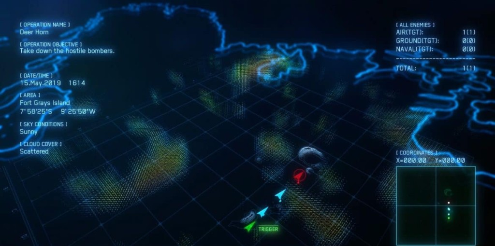

# Design Document: 3D Live Visualization & Scenario Editor ("Phase 3 Expansion")

> This document is the source of truth for a new, self-contained expansion layered on top of the complete WraithNet simulation (Phases 0–10) and the existing 2D Pygame replay viewer (Phases 11–13, `docs/07_Visualization_Design_Document.md`). **Nothing in this document is implemented yet.** See `docs/phases/Phase_14..19_*.md` for the phase-by-phase build plan — each phase is a standalone LLM prompt, mirroring the style already used for Phases 0–13.

## 0. What this expansion is, in one paragraph

Replace "run blind for ~100s, then load a file into a 2D replay viewer" with: **customize the scenario visually, preview it in a cinematic 3D "mission brief" camera, launch the run, and watch it unfold live in a 3D tactical view as it computes** — no waiting for the run to finish, no separate record/replay step required (though the existing file-based replay keeps working, unmodified, as an alternative). This is a superset of what Phases 11–13 offer, not a replacement of them.

## 1. Decisions already made (with the user, before design)

| Decision | Choice | Why it matters architecturally |
|---|---|---|
| 3D engine | **Panda3D** | Pure-Python, mature, has its own scene graph/camera/lighting/GUI toolkit (`DirectGUI`) — no browser, no JS build step, no second language. |
| Live vs. replay | **Cross-process live streaming** (sim and viewer stay separate processes/dependencies; ticks are pushed over a socket as they're produced, not written-then-read from a file) | Preserves the core architectural principle from `docs/07_...md` §2 that's served this project well twice already: **the simulation never imports a rendering library**, so `pytest`/`python -m wraithnet.main` keep working identically on a machine with no 3D libraries installed. |
| Scenario customization | **In-app GUI editor** (visual placement, not just a hand-edited config file) | Biggest scope item; drives the requirement that the scenario itself become a *data* format the sim loads, not a hardcoded Python constant. |
| Existing 2D Pygame viewer (Phases 11–13) | **Kept as-is, not actively extended to track new features** | `viewer/` and `wraithnet/recorder.py` are left completely untouched by this expansion. They still work exactly as before against a `results/trace.jsonl` produced by a scenario-file-driven run — see §3. |

## 2. Architecture overview

```
                    ┌──────────────────────────────┐
                    │   wraithnet (core sim)        │   <- still zero rendering deps
                    │                                │
  scenario.json ───▶│  ScenarioConfig (Phase 14)     │
                    │        │                        │
                    │        ▼                        │
                    │  WraithNetBridge / Model         │
                    │        │                        │
                    │        ├──▶ TraceRecorder  ──────────▶ results/trace.jsonl  (unchanged, Phase 11)
                    │        │        (file sink)      │            │
                    │        │                          │            ▼
                    │        └──▶ LiveStreamServer ─────┼───┐   viewer/ (2D Pygame replay, unchanged, Phase 12-13)
                    │             (socket sink,          │   │
                    │              Phase 15)             │   │
                    └──────────────────────────────┘   │
                                    │ TCP, newline-JSON,      │
                                    │ TraceHeader/TraceTick   │
                                    ▼                         │
                    ┌──────────────────────────────┐         │
                    │   viewer3d (new, Panda3D)      │◀────────┘  (late joiners get full backfill too)
                    │                                │
                    │  stream_client (bg thread)      │
                    │  editor mode  (Phase 18)         │
                    │  mission-brief mode (Phase 17)   │
                    │  live tactical mode (Phase 16-17) │
                    └──────────────────────────────┘
```

Both "sinks" (`TraceRecorder` and `LiveStreamServer`) consume **the exact same `TraceHeader`/`TraceTick` Pydantic models** already defined in `wraithnet/trace_schemas.py` (Phase 11) — this expansion adds a second transport for data that already exists, it does not invent a new data model. This is the single most important reuse decision in this document: it means Phase 15 is almost entirely "take the object that `TraceRecorder.record_tick` already builds, and instead of/in addition to writing it to a file, send it down every connected socket."

## 3. What does *not* change

* `wraithnet/trace_schemas.py`, `wraithnet/recorder.py`, `viewer/` (the whole Phase 12–13 Pygame package), `requirements-viz.txt` — **byte-for-byte unchanged**. A scenario-file-driven run (§4) still optionally writes `results/trace.jsonl`, and `python -m viewer.app results/trace.jsonl` still works exactly as documented in `docs/07_Visualization_Design_Document.md`.
* The core CNP/negotiation/combat logic in `wraithnet/agents.py`, `wraithnet/broker.py`, `wraithnet/world.py` — this expansion is, like Phases 11–13, purely observational/configurational. No phase in this document should need to touch simulation *behavior*, only (a) where scenario data comes from, and (b) additional read-only state export.
* The fixed PoC scenario in `wraithnet/config.py::SCENARIO` — kept as the **default** scenario (see Phase 14), so every existing test that calls `WraithNetModel()`/`WraithNetBridge()` with no arguments keeps passing, unmodified, exactly as Phases 11–13 required for `TraceRecorder`.

## 4. Feature 1: Data-driven scenarios (foundation for everything else)

Today, `wraithnet/config.py::SCENARIO` is a hardcoded dict. An in-app editor needs something it can build up interactively and hand to the simulation — so the scenario becomes a **Pydantic schema + JSON file**, and the fixed PoC scenario becomes just one example file (`scenarios/default.json`) rather than the only possible input.

* **New `wraithnet/scenario_schema.py`**: `ScenarioConfig` (jets, targets, sam_sites, jammers — same shape as today's `SCENARIO` dict, just typed) with `model_validator`s enforcing what was previously just "true by construction of a hand-written dict": unique IDs across all entity lists, all positions within `[0, GRID_WIDTH] × [0, GRID_HEIGHT]`, at least one jet, `hp_required >= 1`, payload counts `>= 0`, etc. This is the same "make an implicit invariant an explicit, enforced one" move `docs/00_Design_Review_Findings.md` made for the original config.
* **New `wraithnet/scenario_io.py`**: `load_scenario(path) -> ScenarioConfig`, `save_scenario(config, path) -> None`. **JSON, not YAML** — the project already has zero YAML dependency anywhere (trace files, results, everything else are JSON/CSV); introducing a YAML library for this one file type would be a new dependency that buys nothing a human/editor-driven JSON file doesn't already give.
* **`WraithNetModel.__init__`/`WraithNetBridge.__init__` gain an optional `scenario: ScenarioConfig | None = None` parameter**, defaulting to `None` → falls back to exactly today's `config.SCENARIO`, converted to a `ScenarioConfig` once at import time. This is the same "optional, defaults to current behavior" pattern Phase 11 used for `recorder`.
* **`wraithnet/main.py` gains a `--scenario PATH` CLI argument** (`argparse`, stdlib only), defaulting to the built-in scenario if omitted. This is what an editor's "Launch" button (Phase 19) will invoke under the hood: `python -m wraithnet.main --scenario path/to/saved.json --live`.
* **New `scenarios/` directory** at the repo root holds `default.json` (the existing fixed scenario, exported once via `save_scenario`, used as a regression fixture proving the round-trip is lossless) and is where the editor (Phase 18) saves user-created scenarios.

This is Phase 14, and it is deliberately the *only* phase that touches `wraithnet/world.py`/`bridge.py`/`main.py` — every later phase only adds new files elsewhere.

## 5. Feature 2: Live tick streaming (foundation for the 3D viewer)

* **Generalize the "sink" concept.** `WraithNetBridge` currently accepts one `recorder: TraceRecorder | None`. This becomes `sinks: list[TraceSink] | None`, where `TraceSink` is a tiny `Protocol` (`record_header(bridge)`, `record_tick(bridge)`, `close()`) that both `TraceRecorder` and the new `LiveStreamServer` implement — so a run can write to a file *and* stream live *at the same time*, or either alone, or neither. `TraceRecorder` itself is **not modified** (it already has exactly this method shape; only the type it's registered under changes name).
* **New `wraithnet/live_stream.py`**: `LiveStreamServer` wraps an `asyncio.start_server` TCP listener (default `localhost:8765`). Wire format is newline-delimited JSON, one object per line, each wrapped with a `type` tag so a client can tell header/tick/end apart on one shared connection:

  ```json
  {"type": "header", "data": { ...TraceHeader fields... }}
  {"type": "tick",   "data": { ...TraceTick fields...   }}
  {"type": "end"}
  ```

* **Backfill-on-connect, then live tail — one mechanism serves both "watch live" and "attach late."** The server keeps every header/tick it has ever sent, in memory, as a list. Any new TCP connection — whether it arrives before the sim starts, mid-run, or after the sim has already finished — immediately receives the full backlog (header, then every tick so far) and is then added to the live fan-out list for anything still to come. **This directly answers the user's "being able to see the scenario live, not having to first run it and only then see it" request**: a viewer can connect *before* the sim even starts (it'll just receive the header immediately, then ticks as they're produced), or mid-run (instant catch-up), or after it's done (acts exactly like a tiny built-in replay server — the same guarantee `viewer/app.py` already gets from a trace file, just over a socket instead).
* **Why raw TCP + newline-JSON, not WebSockets/ZeroMQ/gRPC:** the client is a Python `viewer3d` process on the same machine (or LAN at most), never a browser (that option was explicitly not chosen — see §1) — a bespoke protocol library buys nothing here that `asyncio.start_server` plus a `\n`-terminated JSON line doesn't already give for free, with zero new dependency on the sim side.
* **Why TCP, not a Unix domain socket / named pipe:** TCP on `localhost` works identically on Windows and POSIX; domain sockets/named pipes have OS-specific APIs and this project already runs and is tested on Windows (`user_info` shows `win32`) — no reason to special-case platforms for a same-machine, low-volume protocol.
* **On the client side** (used starting Phase 16), a plain **blocking `socket` read loop on a background `threading.Thread`** — not `asyncio` — decodes incoming lines into `TraceHeader`/`TraceTick` (via `.model_validate_json` — the exact same Pydantic models, reused, not reimplemented) and pushes them onto a thread-safe `queue.Queue`. Panda3D's own main loop (`taskMgr`) drains that queue once per rendered frame. This sidesteps needing Panda3D to understand `asyncio` at all — a plain queue-draining task is the simplest thing that reliably works across Panda3D versions.
* Phase 15 is proven correct with a **pure-`asyncio`, Panda3D-free test client** (a small helper used only by `tests/test_live_stream.py`) — exactly like Phase 11 proved `TraceRecorder` correct without ever importing Pygame. Panda3D enters the picture only in Phase 16.

## 6. Feature 3: The Panda3D viewer (`viewer3d/`, new top-level package)

Sibling to `viewer/`, same isolation principle: `wraithnet/` never imports `panda3d`; a new `requirements-3d.txt` (`-r requirements.txt` + `panda3d`) is the only place that dependency is declared.

```
viewer3d/
    __init__.py
    stream_client.py   # bg-thread TCP client -> queue.Queue of (header | tick) events (Phase 15/16)
    scene.py            # builds/updates the 3D scene graph from header + latest tick (Phase 16)
    cameras.py          # orbit / chase / mission-brief cinematic camera controllers (Phase 17)
    hud.py              # DirectGUI/OnscreenText 2D overlay (Phase 17)
    editor.py           # scenario editor mode: top-down ortho camera + entity forms (Phase 18)
    app.py              # entrypoint, mode switching, Launch integration (Phase 16 skeleton, Phase 19 full)
requirements-3d.txt
```

### 6.1 Coordinate mapping (much simpler than the 2D viewer's y-flip)

The sim's world is 2D: `(x, y)` on a `100×100` grid, `y` "up." Panda3D's default convention is **Z-up**, with the ground plane spanned by X and Y. That means the natural mapping is direct, with no axis flip needed at all:

| Sim | Panda3D |
|---|---|
| `x` | `x` |
| `y` | `y` |
| *(none — sim is 2D)* | `z` = synthetic altitude (see 6.2) |

### 6.2 Synthetic altitude — explicit scope boundary

**The simulation itself stays 2D.** There is no altitude in `wraithnet`'s data model, no altitude-based gameplay (no terrain-following, no vertical evasion, no altitude affecting sensor/SAM range) — this is an explicit non-goal (§8), not an oversight. The 3D viewer alone decides, purely for presentation, to render jets at a fixed flight altitude (e.g. `z = 8` world-units) above a ground plane at `z = 0`, with targets/SAM sites/the jammer sitting on the ground (`z = 0`). This gives an "aircraft flying over a map" look without requiring any change to the tactical model Phases 0–10 already validated. If two jets ever occupy the exact same `(x, y)`, a small deterministic per-jet vertical offset (keyed by index in `jet_ids`, same pattern the 2D viewer uses for its color palette) prevents them from perfectly overlapping — purely cosmetic, never affects gameplay.

### 6.3 Visual style reference: Ace Combat's holographic mission-briefing map



This is the concrete look both the mission-brief camera (§7) and, to a lesser degree, the live-tactical view are aiming for — not a rendering-fidelity target (no lighting/shadows/PBR materials, no terrain heightmaps, no real assets; all of that is still an explicit non-goal, §10), but a **stylistic** one that happens to be very cheap to build with flat-colored/emissive primitives, which is exactly what §6.3's placeholder-geometry constraint already committed to. Concretely, four things carry over directly into this design:

1. **Dark background + glowing wireframe grid ground, not a solid-shaded terrain.** WraithNet's world is flat (no elevation data, §6.2), so there's no heightmap to fake — but the reference's *grid* (thin glowing lines over a near-black plane) is exactly the existing `draw_grid_background`-style ground concept (already planned in §6.3/Phase 16) rendered as an emissive wireframe material instead of a shaded solid. Cheap, on-brand, no new data needed.
2. **Flat, billboarded glyph markers instead of solid 3D-shape primitives per entity.** The reference doesn't model 3D tanks/planes — it uses simple glowing 2D icons (a chevron/triangle for a waypoint or aircraft, a circled slash for a hostile target) that always face the camera. This is a **simplification** of what §6.3 originally sketched (boxes/octahedra/cylinders) and is adopted as the actual plan: each jet/target/SAM/jammer is a small camera-facing billboard (`panda3d`'s built-in billboard effect on a textured/`CardMaker`-built quad, or vertex-colored unshaded geometry if no texture is used), not a distinct solid shape per type. Update the entity table below accordingly — this replaces the shape column from the original sketch of this section.
3. **Corner-anchored, bracket-labeled HUD panels, not a single dense sidebar.** See §6.5's rewrite below — the reference's `[ OPERATION NAME ]`/`[ ALL ENEMIES ]`/`[ COORDINATES ]` panel layout (top-left info block, top-right tabular counts, bottom-right coordinate readout + a small radar/minimap) is adopted as the concrete HUD layout for both mission-brief and live-tactical modes, in place of the more generic sidebar sketched earlier.
4. **A monochrome cyan/blue palette with sparse accent colors** (red for hostile, green/teal for friendly/objective markers) — carried over as the default color scheme for the mission-brief camera specifically (§7); the live-tactical view keeps the existing per-jet palette (`viewer/render.py::JET_PALETTE`, for visual continuity with the 2D viewer) once ticks start arriving and role/HP/jam state need to be legible at a glance, which matters more than strict palette purity once the mission is actually running.

Revised entity table (billboards, not solids):

| Entity | Billboard glyph | Notes |
|---|---|---|
| Jet | Chevron/triangle icon, camera-facing, rotated in-plane to point toward its heading (derived from the last two received positions) | Colored per the same fixed palette `viewer/render.py::JET_PALETTE` already uses once live-tactical mode is active; cyan/monochrome while in mission-brief mode (§7, point 4 above). |
| `HARDENED_BUNKER` | Square/box glyph | |
| `MOBILE_RADAR` | Diamond glyph | |
| `SAM_SITE` (alive) | Circle-with-slash glyph (direct reference to the image's hostile-target marker) + a translucent flattened disc at `sam_engagement_range` (3D analogue of the 2D dashed ring) | |
| Jammer | Small pylon/hex glyph + a translucent dome/disc at `jam_radius` | |
| Destroyed target/jet | Same rule as the 2D viewer: destroyed targets fade to a dim grey outline glyph in place; destroyed jets are removed from the scene the tick they disappear from `TraceTick.jets` (no tombstone) | |

This section supersedes the original solid-primitive sketch that existed here before this style reference was provided — Phase 16/17's docs have been updated to match.

### 6.4 Camera modes ("Ace Combat" framing)

Three modes, all switchable at runtime with a key/GUI button, all reusing the same underlying scene:

1. **Free orbit** — mouse-drag rotates around the map's center at a fixed radius/tilt; the default for casually watching the whole board, and what the mission-brief mode's auto-pan is a scripted version of.
2. **Chase/follow** — camera trails a short distance behind and above a selected jet, banking toward its heading; the explicit "Ace Combat" reference — select a jet (click it, or cycle with a hotkey) and watch the battle from its perspective.
3. **Mission brief (cinematic)** — a slow, scripted orbit/pan over the map, active automatically whenever the viewer has a `TraceHeader` but **no ticks yet** (i.e., connected before the sim started, or previewing a scenario in the editor that hasn't been launched) — see §7.

### 6.5 HUD — corner-anchored bracket panels (per §6.3's style reference)

Rather than one dense sidebar (the 2D viewer's approach, which stays exactly as-is in `viewer/`), `viewer3d`'s HUD is split into small, corner-anchored panels matching the reference image's layout, each using the same `[ BRACKETED LABEL ]` + monospace-value convention:

| Panel | Corner | Content |
|---|---|---|
| Mission info | Top-left | `[ SCENARIO ]` name/path, `[ STATUS ]` (connecting / mission brief / live / finished), `[ TICK ]` current/total-so-far |
| Force status | Top-right | A small table analogous to the reference's `[ ALL ENEMIES ]` box: targets remaining by type (bunker/radar/SAM), jets remaining, mirroring `viewer/render.py`'s existing "Targets X/Y destroyed" / "Jets X/Y alive" HUD lines but laid out as a bracketed table instead of prose lines |
| Coordinates + minimap | Bottom-right | `[ COORDINATES ]` of the currently selected/followed jet (or camera focus point in orbit mode), plus a small top-down radar-style minimap (a flat, tiny orthographic render or a hand-drawn 2D dot-plot of jet/target positions — implementation detail for Phase 17 — directly modeled on the reference's bottom-right radar box) |
| Controls/legend | Bottom-left (new, not in the reference image but needed for usability) | Camera-mode indicator + key bindings, analogous to `viewer/render.py::draw_hud`'s existing "Controls" section |

Connection status, per-jet role/HP legend details, and the end-of-run summary overlay (computed the same way as the 2D viewer, by diffing/summing the ticks received so far — no new data needed) are distributed across these panels rather than one combined block, but no information from the original single-sidebar sketch is dropped — this is a layout change, not a scope change.

## 7. Feature 4: "Mission brief" mode is not a separate feature — it's a mode with no ticks yet

This is the key insight that keeps this expansion coherent instead of turning into three unrelated tools: **`viewer3d`'s scene-building code (§6.3) only ever needs a `TraceHeader` to draw the static picture** (grid, initial jet positions, target positions/types, SAM ranges, jammer). A `TraceTick` is only needed to *animate* it. That means:

* **Mission brief = header received, zero ticks received yet, cinematic camera active, reference-style palette.** This is naturally what a viewer sees if it connects to a `LiveStreamServer` before the sim has started stepping (§5) — no special "brief mode" data or endpoint is needed, it falls out of the streaming protocol's own ordering guarantee (header always arrives first, ticks follow later, possibly much later or never if the sim hasn't been launched yet). Visually, this is the mode that should look most like §6.3's reference image: the monochrome cyan/blue billboard glyphs and bracket-panel HUD, before role/HP/jam-state color coding (which only matters once things start happening) takes over in live-tactical mode.
* **Scenario editor preview reuses exactly this.** The editor (§8, Phase 18) builds a `TraceHeader`-shaped object directly from the in-progress `ScenarioConfig` being edited (no sim, no socket, no ticks at all — just the same header-only rendering path fed synthetic data) so "preview my scenario" is the same code path as "connect early and wait for the sim to start," not a third rendering mode to build and maintain separately.
* **Transition to live tactical mode happens automatically** the moment the first real `TraceTick` arrives — the camera hands off from its scripted cinematic path to whichever tactical mode (orbit/chase) was last active (default: orbit), and the HUD switches from "awaiting launch" to live tick counters.

## 8. Feature 5: Scenario editor (`viewer3d/editor.py`)

* **Built inside the same Panda3D app, not a separate Pygame tool.** Given the engine choice (Panda3D, §1) and the reuse insight in §7, adding a second GUI toolkit (Pygame again, or a web form) for just the editor would duplicate camera/scene-building code for no benefit. The editor is one more *mode* of `viewer3d.app`, alongside mission-brief and live-tactical.
* **Top-down orthographic camera while editing** (not the perspective "Ace Combat" camera) — placement precision matters more than cinematic flair here, and the sim's own coordinate space is inherently 2D (`(x, y)` only, §6.2), so an orthographic top-down view maps 1:1 onto "click here to place this entity" with no depth ambiguity. This is a deliberate, explicit choice, not an oversight — it's the same reason the 2D Pygame viewer used a flat top-down map in the first place.
* **DirectGUI panels** for: an entity list (jets/targets/SAM sites/jammers currently in the scenario), an "Add [entity type]" flow (click on the ground plane to place, then fill in a form — payload counts for jets, `target_type`/`hp_required` for targets, nothing extra for the jammer), per-entity edit/delete, and Save/Load buttons wired to Phase 14's `scenario_io.save_scenario`/`load_scenario`.
* **Validation surfaces Phase 14's Pydantic errors as UI messages, not stack traces** — e.g. "two entities cannot share an ID," "position must be inside the grid," "at least one jet is required" — reusing the exact `ScenarioConfig` validators, not a second, editor-only copy of the same rules.
* **"Preview" button** switches the same window into mission-brief mode (§7) rendering the in-progress `ScenarioConfig` with zero ticks, so a user can sanity-check placement/scale before committing.
* **"Launch" button** is Phase 19's job (§9) — it's the bridge from "I've finished customizing" to "now show me this scenario live."

## 9. Feature 6: Launch integration (Phase 19)

Pressing "Launch" in the editor:

1. Saves the current in-progress scenario to disk (`scenarios/<name>.json`, via `scenario_io.save_scenario`).
2. Spawns `python -m wraithnet.main --scenario scenarios/<name>.json --live` as a **subprocess** (`subprocess.Popen`, not a thread/import — keeps `wraithnet`'s asyncio event loop and `viewer3d`'s Panda3D loop in genuinely separate processes/interpreters, exactly matching §1's "cross-process" decision, and means a sim crash can't take the viewer down or vice versa).
3. The same `viewer3d` window switches from editor mode to mission-brief mode **immediately**, using the just-saved scenario's data to build the header-only preview — it does not wait for the subprocess to start, connect, or produce anything (§7 already made this free).
4. `viewer3d`'s `stream_client` connects to the subprocess's `LiveStreamServer` (retrying briefly if the subprocess hasn't opened its listening socket yet — a short bounded retry loop, not a hang) and the moment the header arrives (confirming connection) and then the first tick arrives (confirming the sim has actually started stepping), the camera/HUD hand off from mission-brief to live-tactical exactly as §7 describes.

This closes the loop the user asked for: **customize → brief → live**, all inside one running `viewer3d` process, with the actual tactical simulation running as an independent, swappable, headless-capable subprocess underneath it — never coupled to the renderer, exactly like every other visualization feature this project has built so far.

## 10. Explicit non-goals

* **No change to simulation tactics/behavior, timing, or determinism.** Every existing test that constructs `WraithNetModel()`/`WraithNetBridge()` with no arguments must keep passing unmodified, exactly as Phases 11–13 required.
* **No altitude-based gameplay** (§6.2) — altitude is a rendering-only fiction; SAM range, sensor range, jamming, movement speed all remain the existing 2D-plane calculations, untouched.
* **No 3D asset pipeline, no textured/modeled aircraft, terrain, or buildings** (§6.3) — procedural placeholder primitives only. A future "make it pretty" phase is welcome to swap primitives for real assets without touching any other phase's contract (`scene.py`'s job is "given this header/tick data, produce/update these node transforms" — the geometry used for a given node is an internal implementation detail it alone owns).
* **No networked/remote viewing across machines** — `LiveStreamServer` binds `localhost` by default; nothing in this design prevents binding a real interface later, but it is not a requirement now and adds no complexity to defer.
* **No authentication/encryption on the live stream** — same-machine, single-user, ephemeral, PoC-only; not a concern at this scope.
* **No physics engine, no collision detection in 3D** — Panda3D is used purely as a scene-graph/renderer/GUI toolkit here, not a physics simulator; all "did X hit Y" logic stays exactly where it already lives, in `wraithnet/world.py`.
* **No mobile/VR/controller support** — mouse + keyboard only, matching the existing 2D viewer's input model.
* **The 2D Pygame viewer (`viewer/`) is not extended, refactored, or feature-matched to the 3D viewer** — it is a complete, working, separately-maintained tool per §3, kept purely for whoever prefers a fast, dependency-light replay of a `trace.jsonl` file.

## 11. Implementation phases for the LLM

Build strictly in this order — each phase's "done" state is a hard prerequisite for the next:

* **Phase 14 — Scenario Schema, IO & Config-Driven World** (`docs/phases/Phase_14_Scenario_Schema_and_Config_Driven_World.md`): `wraithnet/scenario_schema.py`, `wraithnet/scenario_io.py`, `scenarios/default.json`, optional `scenario` parameter threaded through `WraithNetModel`/`WraithNetBridge`, `--scenario` CLI flag on `main.py`. Zero 3D/GUI/networking. Foundation for everything else.
* **Phase 15 — Live Tick Streaming Protocol** (`docs/phases/Phase_15_Live_Tick_Streaming_Protocol.md`): `TraceSink` protocol, `wraithnet/live_stream.py::LiveStreamServer`, multi-sink support in `WraithNetBridge`, `--live`/`--live-port` CLI flags. Pure `asyncio`/Pydantic, tested with a Panda3D-free test client. Foundation for the 3D viewer's data feed.
* **Phase 16 — Panda3D Viewer Skeleton: Static Scene & Live Stream Client** (`docs/phases/Phase_16_Panda3D_Viewer_Skeleton_and_Live_Scene.md`): `requirements-3d.txt`, `viewer3d/stream_client.py`, `viewer3d/scene.py`, minimal `viewer3d/app.py` — connect, receive header, build static scene, drain queue and update entity transforms per tick, one fixed camera. Proves the end-to-end pipe works.
* **Phase 17 — Camera Modes, HUD & Mission Brief** (`docs/phases/Phase_17_Camera_Modes_HUD_and_Mission_Brief.md`): `viewer3d/cameras.py` (orbit/chase/cinematic), `viewer3d/hud.py`, the header-only-vs-ticks-arrived mode handoff (§7), event highlights (strike/destruction/jam flashes, computed by diffing consecutive received ticks in memory).
* **Phase 18 — Scenario Editor** (`docs/phases/Phase_18_Scenario_Editor.md`): `viewer3d/editor.py`, top-down ortho camera, DirectGUI entity CRUD forms, Save/Load via Phase 14's `scenario_io`, validation-error surfacing, Preview button (reuses Phase 17's mission-brief mode against an in-progress `ScenarioConfig`).
* **Phase 19 — Editor → Brief → Live Launch Integration** (`docs/phases/Phase_19_Editor_Launch_Integration.md`): Launch button, `subprocess.Popen`-based sim launch, mode handoff sequencing (editor → mission-brief → live-tactical), bounded connection-retry logic.
